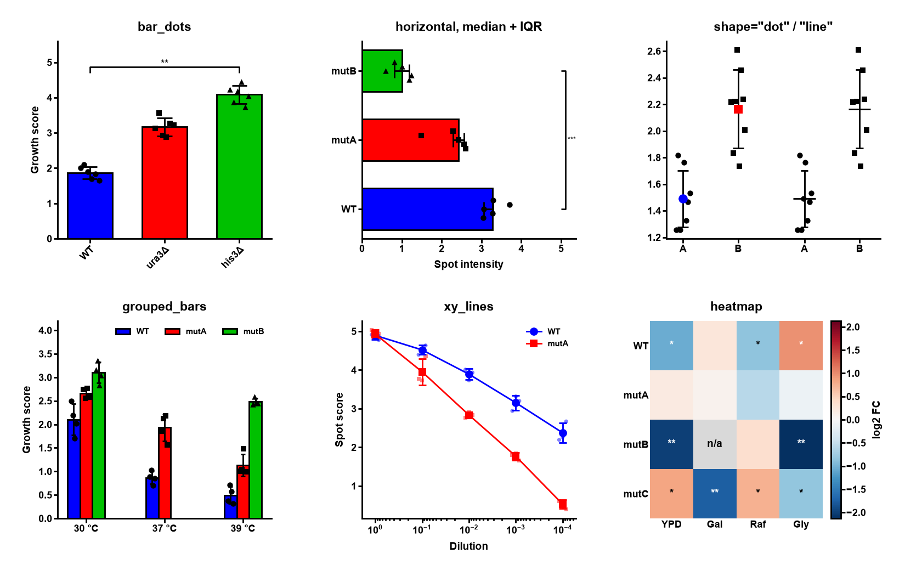

# PyPrism Plot

GraphPrism-inspired, publication-ready styling for Python's Matplotlib and Seaborn
ecosystem. PyPrism Plot provides a focused theme, curated discrete palettes, and
statistical annotation helpers while leaving plotting and data manipulation to the
libraries you already use.

## Install, import, and plot

PyPrism Plot is a regular Python library. Install it into the Python
environment you already use:

```bash
python -m pip install git+https://github.com/darrentymeczko/PyPrism_Plots.git
```

No Git on your computer? Install the same code from its ZIP instead:

```bash
python -m pip install https://github.com/darrentymeczko/PyPrism_Plots/archive/refs/heads/main.zip
```

Python 3.10+ is required; Matplotlib, NumPy and pandas are installed automatically. In a
Jupyter notebook, run `%pip install ...` in a cell so the package goes into the notebook's
own Python.

Then import it alongside Matplotlib and call its functions directly:

```python
import matplotlib.pyplot as plt
import pyprism_plot as ppp

# Apply the style to all Matplotlib plots created from this point onward.
ppp.use_prism(palette="colorblind_safe")

fig, ax = plt.subplots()
ax.plot([1, 2, 3, 4], [2.1, 3.4, 3.8, 5.2], marker="o")
ax.set(xlabel="Time (hours)", ylabel="Response", title="Treatment response")
plt.show()
```

The package name used during installation is `pyprism-plot`, while the import name
is `pyprism_plot`.

> [!NOTE]
> This independent open-source project is not affiliated with, endorsed by, or
> sponsored by GraphPad Software. GraphPad and Prism are trademarks of their
> respective owner. The project follows the open-source
> [`ggprism`](https://github.com/csdaw/ggprism) package (GPL-3) with an original
> Python implementation. Its colour, fill and shape palettes are ggprism's palette
> data (which ggprism took from GraphPad Prism's colour schemes); see
> `src/pyprism_plot/_ggprism_palettes.py`.

## Common ways to use PyPrism Plot

### Style every subsequent plot

Call `use_prism()` once near the top of a script or notebook:

```python
import pyprism_plot as ppp

ppp.use_prism()
```

### Style only part of a script

Use `prism_context()` when you want the settings restored afterward:

```python
import matplotlib.pyplot as plt
import pyprism_plot as ppp

with ppp.prism_context(palette="floral", border=True):
    fig, ax = plt.subplots()
    ax.bar(["Control", "Drug A", "Drug B"], [2.2, 3.1, 4.4])
    ax.set(ylabel="Response", title="Experiment results")
```

### Style an axes that already exists

`style_axes()` works with plots made by Matplotlib or Seaborn:

```python
import seaborn as sns
import pyprism_plot as ppp

ax = sns.scatterplot(data=my_data, x="time", y="response", hue="treatment")
ppp.style_axes(ax, minor_ticks=True)
```

### Use palettes and significance annotations

```python
import matplotlib.pyplot as plt
import pyprism_plot as ppp

values = [2.2, 3.1, 4.4, 5.0]
fig, ax = plt.subplots()
colors = ppp.get_palette("colorblind_safe", 4)
ax.bar(range(4), values, color=colors)
ppp.significance_bar(ax, 0, 3, y=5.2, text="p < 0.01")
```

The default significance bracket is sized for publication figures. Its height,
line width, label size, and label spacing can all be adjusted independently:

```python
ppp.significance_bar(
    ax,
    0,
    3,
    y=5.2,
    text="p < 0.01",
    height=0.2,
    line_width=2.0,
    font_size=14,
    text_offset=0.08,
)
```

For horizontal graphs, `significance_bar_h()` spans two y positions at a given x,
with its ticks pointing left and the label to the right:

```python
ppp.significance_bar_h(ax, 0, 2, x=5.0, text="***", font_size=10)
```

### Fixed-size pages and tick labels

`prism_style()`, `prism_context()`, and `use_prism()` accept two options for
figures laid out on a page of fixed size:

```python
with ppp.prism_context(tight_save=False, explicit_fonts=True):
    ...
```

- `tight_save=False` sets `savefig.bbox` to `"standard"`, so saving does not crop
  the page.
- `explicit_fonts=True` stores the concrete font list in `font.family`, so text
  keeps its font when the figure is saved after the context exits.

`style_axes()` rotates x tick labels by any angle. Pass `axis_text_ha="right"` to
anchor the end of each label on its tick, which suits 45 degree category labels:

```python
ppp.style_axes(ax, axis_text_angle=45, axis_text_ha="right")
```

### The Prism look, offset axes and minor ticks

Sizes follow ggprism's `theme_prism(base_size, base_line_size)`. Axis lines and
ticks are `base_line_size × 2.134` pt (2.13 pt at the default `base_size=14`; one
ggplot2 linewidth unit is 0.75 mm). Ticks point out and are `base_size / 2.5` pt
long, minor ticks `base_size / 5`. All text is bold black Arial, and there is no
grid and no legend frame.

`style_axes()` adds ggprism's axis guides. `offset=` gives `guide_prism_offset`:
the axis line stops at the outermost ticks and the axes move apart so they don't
meet at the corner. `minor_ticks=` gives `guide_prism_minor`, with one minor tick
between major ticks (2-9 per decade on log axes). Both are off by default, as in
`theme_prism()`:

```python
ppp.style_axes(ax, offset="y", minor_ticks="y")
```

Every default and its source is listed in
[`docs/prism-defaults.md`](docs/prism-defaults.md). Pass `style="classic"` to any
plotting function, `prism_style()` or `style_axes()` to get the PyPrism 0.2 look
back.

## Plotting functions

PyPrism also draws the common Prism graph types. Each function takes an existing
axes, draws only into it, and returns a small dataclass holding every artist it
created, grouped per category or series (call `.artists()` for a flat list).
Positions and widths are in data units, every style is a keyword argument, and
`autoscale=False` leaves the axis limits alone. Text uses the rcParams in effect
unless you pass `font_size`.

Error bars follow Matplotlib's `yerr` convention: pass symmetric distances as
`err=sd`, asymmetric distances as `err=(lower, upper)`, or absolute interval ends
as `bounds=(low, high)`. NaN or `None` values are skipped without moving the
other categories.



### Columns with replicate points: `bar_dots`

```python
import matplotlib.pyplot as plt
import numpy as np
import pyprism_plot as ppp

reps = [np.array([1.8, 2.1, 2.3]), np.array([3.0, 3.4, 2.9]), None]
fig, ax = plt.subplots()
result = ppp.bar_dots(ax, reps, labels=["WT", "mutA", "mutB"])
result.bars[0].set_gid("bar-WT")  # bars[i], errorbars[i], points[i], labels[i]
```

By default this is Prism's column bar graph with the points shown:
- solid columns in the palette colour with a black outline at the axis line width
- black mean ± SD error bars with caps a third of the column wide
- black points in ggprism's shapes, a different shape per column (circle, square,
  triangle, diamond, ...)

`err_direction="up"` keeps only the upper half of each error bar. Points are
spread evenly (not randomly), so redraws match. Use `orientation="horizontal"` for bars that grow to the right,
`shape="dot"` or `shape="line"` to mark the centre instead of drawing a column,
and `centre=`/`err=`/`bounds=` to plot your own summary statistics:

```python
ppp.bar_dots(
    ax,
    reps,
    orientation="horizontal",
    positions=[0.0, 1.5, 3.0],
    width=0.8,
    centre=medians,
    bounds=(q1, q3),
)
```

### Grouped columns: `grouped_bars`

`data[cluster][series]` holds replicates, or `None` for an empty slot. Artists
are keyed by `(cluster, series)`, and `legend_handles` lets you place the legend
yourself:

```python
result = ppp.grouped_bars(
    ax,
    [[wt_30, mut_30], [wt_37, None]],
    cluster_labels=["30 °C", "37 °C"],
    series_labels=["WT", "mutA"],
)
ax.legend(handles=result.legend_handles, loc="upper right")
```

### Lines with error bars: `xy_lines`

Each series is a y array or a `(y, low, high)` tuple. NaN values break the line.
Replicate points can be drawn behind the lines:

```python
result = ppp.xy_lines(
    ax,
    [1, 0.1, 0.01, 0.001],
    {"WT": wt_mean, "mutA": (mut_median, mut_q1, mut_q3)},
    err={"WT": wt_sem},
    points={"WT": wt_replicates},  # one array of replicates per x
    logx=True,
)
result.series["WT"].line.set_gid("line-WT")
```

### Heatmap with a colour bar: `heatmap`

```python
result = ppp.heatmap(
    ax,
    matrix,
    row_labels=strains,
    col_labels=conditions,
    annotations=stars,  # matrix of strings, or True to print the values
    cbar_ax=cax,  # optional: an axes you placed for the colour bar
    cbar_label="log2 FC",
)
```

The colormap is centred on `center=0` by default, NaN cells are light grey and
labelled `n/a` when annotations are on, and the cell text switches between dark
and light for contrast. Without `cbar_ax`, the colour bar goes in an inset to the
right of the axes, so the axes keeps its size and position.

## Features

- Clean white panels, bold typography, outward ticks, heavy axes, and no grid
- Global, temporary-context, and single-axes styling APIs
- All of ggprism's colour, fill and shape palettes, plus PyPrism's own
- Optional full panel borders, minor ticks and Prism's offset axes
- Significance brackets for vertical and horizontal graphs
- Axes-level column, grouped column, XY line, and heatmap plots that return
  every artist they draw
- Native compatibility with Matplotlib and Seaborn

## Complete example

```python
import matplotlib.pyplot as plt
import numpy as np
import pyprism_plot as ppp

x = np.arange(4)
means = [2.2, 3.1, 4.4, 5.0]

with ppp.prism_context(palette="colorblind_safe"):
    fig, ax = plt.subplots(figsize=(5, 4))
    ax.bar(x, means, color=ppp.get_palette("colorblind_safe", 4))
    ax.set(xlabel="Treatment", ylabel="Response", title="Dose response")
    ax.set_xticks(x, ["Control", "Low", "Medium", "High"])
    ppp.significance_bar(ax, 0, 3, 5.2, "p < 0.01")
    fig.savefig("dose-response.svg")
```

See [`examples/gallery.py`](examples/gallery.py) for Matplotlib, Seaborn, and
plotting-function examples. Run it to write `examples/pyprism_gallery.png` and
`examples/pyprism_plots_gallery.png`:

```bash
python examples/gallery.py
```

## Development setup

The Conda environment is for contributors and maintainers only. From a cloned
repository:

```bash
conda env create -f environment.yml
conda activate pyprism
```

Alternatively, create or activate any Python 3.10+ environment and install the
development dependencies:

```bash
python -m pip install -e ".[dev]"
```

Run the project checks with:

```bash
pytest
ruff check .
python -m build
twine check dist/*
```

Pull requests are welcome. Please read [CONTRIBUTING.md](CONTRIBUTING.md) first.

## Design references

The API and styling goals were informed by `ggprism`, particularly its
`theme_prism()`, discrete color/fill scales, optional borders, axis text angle,
minor tick guide, and p-value annotation features. Matplotlib concepts are used
where they fit naturally rather than reproducing ggplot2 internals.

## License

MIT. See [LICENSE](LICENSE).
